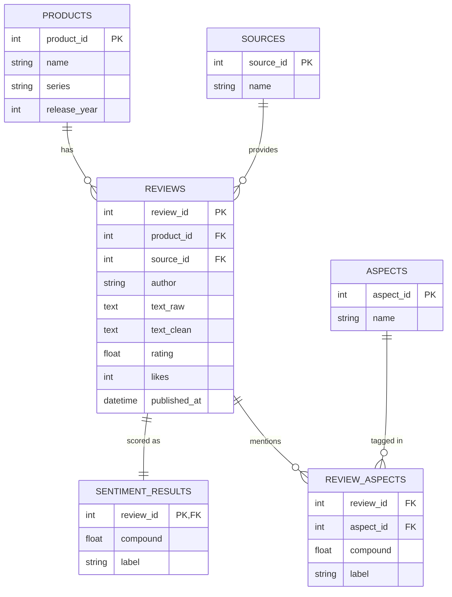

# ERD (Entity Relationship Diagram)

GitHub renders the diagram below automatically (Mermaid).

## Relationships in words
- One **product** has many **reviews** (1 : N).
- One **source** (YouTube, web site) provides many **reviews** (1 : N).
- One **review** has exactly one **sentiment result** (1 : 1).
- A **review** can mention many **aspects** and an **aspect** appears in many reviews (M : N), resolved by the `review_aspects` table.
